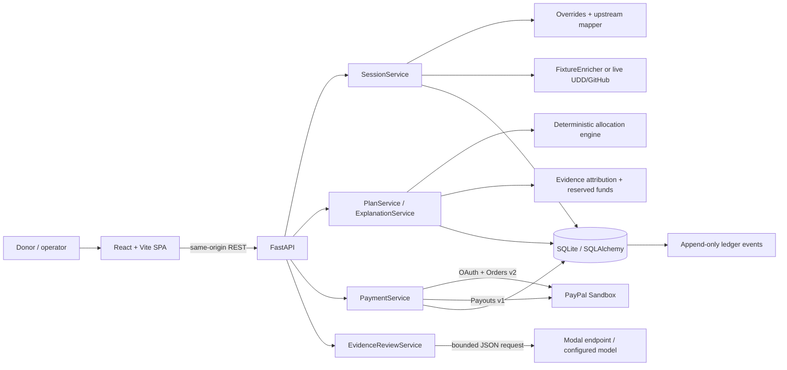
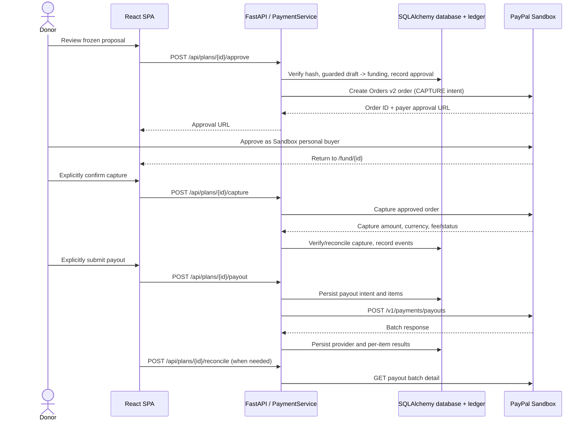

# Technological Implementation

## Executive overview

Dividend is a single FastAPI application with a React/Vite browser client, SQLAlchemy persistence, deterministic allocation services, an append-only ledger, an optional Modal-hosted AI evidence review, and a PayPal Sandbox provider. Package discovery, proposal preparation, payment collection, and payout are separate steps. The browser cannot choose payment amounts or recipient emails; payment amounts and payees come from the stored plan.

The most important boundary is between interpretation and financial control: AI can summarize supplied contribution evidence. It does not decide the project budget split, change a plan, approve an order, capture funds, or start a payout. `dividend/allocation/engine.py` and `dividend/allocation/maintainer.py` make deterministic decisions from typed facts, a versioned policy, and validated evidence.

## Architecture overview



This diagram shows the live application path. `dividend/upstream/resolver.py` contains a constrained LLM proposal/verification helper, but `create_app()`'s current fixture/live session runners do not inject a resolver into `SessionService.resolve_sources`. The running application therefore leaves unresolved sources unmapped; the helper should not be presented as an active Modal-powered mapping stage.

## Technology stack

| Area | Implemented technology |
|---|---|
| API | Python, FastAPI, Pydantic v2 |
| Persistence | SQLAlchemy, SQLite by default; configuration accepts supported SQLite/PostgreSQL URLs |
| Web client | React, TypeScript, Vite, TanStack Query, CSS |
| PayPal | PayPal Python SDK for Orders v2; direct authenticated HTTP for Payouts v1 |
| AI | OpenAI-compatible client to a configured Modal endpoint, default model `deepseek-ai/DeepSeek-V4.1-Flash-1017` |
| Local/hosted packaging | Docker multi-stage build, Docker Compose, Render Docker manifest |
| Tests | pytest backend tests; Node's built-in test runner for frontend helper tests |

No LangGraph, Redis, Celery, SSE, or frontend state store is required by the running application. The SPA uses local component state and TanStack Query for server requests.

## Backend and API

`create_app()` in `dividend/main.py` constructs the FastAPI application and wires the database, provider, evidence review, middleware, routers, startup initialization, and static frontend. `dividend/api/` delegates requests to services rather than hosting allocation/payment rules in route functions. The main service boundaries are:

- `SessionService` validates demo, upload, or paste intake and records source resolution.
- `PlanService` assembles inputs, calls deterministic allocation and attribution, stores lines, and freezes a proposal snapshot/hash.
- `ExplanationService` returns rule-based plan explanations.
- `EvidenceReviewService` requests and validates AI summaries of frozen evidence.
- `PaymentService` owns guarded payment state transitions and is the only application service calling `PaymentsProvider`.
- `MaintainerClaimService` handles invitation-backed GitHub identity claims when OAuth credentials are configured.

Core REST endpoints implemented in `dividend/api/routes_sessions.py`, `routes_plans.py`, and `routes_workspace.py`:

| Endpoint | Purpose |
|---|---|
| `GET /health`, `GET /config` | Health/config summary; the health response contains no credentials. |
| `GET /api/workspace` | Session and plan activity references. |
| `POST /api/sessions` | Create a `demo`, `upload`, or `paste` session. |
| `GET /api/sessions/{session_id}` | Read session status. |
| `GET /api/sessions/{session_id}/projects` | Read mapped, unmapped, and no-upstream sources. |
| `POST /api/sessions/{session_id}/plans` | Create a funding plan for a resolved session. |
| `GET /api/plans/{plan_id}` | Read a plan; plan access is checked. |
| `GET /api/plans/{plan_id}/explanations` | Read deterministic explanations. |
| `GET /api/plans/{plan_id}/evidence-review` | Request/read the optional donor-facing AI review. |
| `PATCH /api/plans/{plan_id}/budget` | Adjust an eligible draft plan. |
| `POST /api/plans/{plan_id}/approve` | Freeze/approve for funding and create a PayPal order. |
| `POST /api/plans/{plan_id}/capture` | Explicitly capture an approved order. |
| `POST /api/plans/{plan_id}/payout` | Explicitly submit the payout batch. |
| `POST /api/plans/{plan_id}/payout/retry` | Retry only eligible failed payout items. |
| `POST /api/plans/{plan_id}/reconcile`, `GET /api/plans/{plan_id}/payouts` | Reconcile/read payout states. |
| `POST /api/plans/{plan_id}/cancel` | Cancel an eligible plan. |
| `POST /api/synthetic-sandbox-demo` | Create the separate, visibly labelled synthetic Sandbox plan. |

Plan-specific routes use a signed plan access token. API validation and business errors return machine-readable codes and request IDs. Maintainer claim routes are in `dividend/api/routes_maintainer_claims.py`.

## Frontend architecture and workflow

The browser entry is `frontend/src/main.tsx`; `frontend/src/App.tsx` maps paths to screens. `frontend/src/api.ts` centralizes requests. TanStack Query owns fetched session/plan data; components hold transient form and interaction state.

Main routes are `/`, `/discovery/:sessionId`, `/allocation/:planId`, `/fund/:planId`, `/payouts/:planId`, and `/claim`. `App.tsx` starts package discovery/import or the synthetic demo. `Discovery.tsx` shows mapping results. `AllocationReview.tsx` presents project amounts, reserved amounts, deterministic reasons, and—when available—evidence review. `FundScreen.tsx` separates order creation, external payer approval, and capture confirmation. `Payouts.tsx` previews recipient totals and requires a separate payout action. `WorkspaceActivity.tsx` lists sessions/plans and their known states.

The synthetic workflow displays a persistent warning in `SyntheticDemoBanner.tsx`; it hides the evidence-review and budget-adjustment controls that do not apply to the fixed fictional fixture. It is not presented as GitHub-verified contribution activity.

## Persistence and data model

`dividend/models.py` defines sessions, source resolutions, upstream projects, maintainers and additional recipients, claims, plans and plan lines, payment operations, payout batches/items, synthetic Sandbox recipients, the LLM cache, and ledger events. Money is integer cents and currency is USD. `dividend/db.py` initializes registered SQLAlchemy metadata and applies additive SQLite upgrades; this repository does not use Alembic.

The proposal hash covers the canonical approval snapshot, including project totals, recipient splits, evidence snapshot references, fee policy, and synthetic metadata where applicable. Plan services verify the hash and persisted line totals before payment actions. SQLite WAL/foreign-key settings are applied on SQLite connections. Database seeding is guarded so the demo fixture is added only to an empty database when `DEMO_SEED_ON_BOOT` is enabled.

## Package discovery and upstream mapping

`dividend/scan.py` runs `dpkg-query`, keeps installed (`ii`) packages, groups binary package names by Debian source package, and emits a schema-1 JSON report with origin and counts. `dividend/cli.py` exposes:

```text
python -m dividend scan [--demo] [-o OUTPUT]
python -m dividend configure-sandbox-recipients --database-url URL --file FILE
```

Session intake validates package-name syntax, unique names, upload shape, and a 5,000-source maximum. `SessionService` records a resolving session and queues the resolution work with FastAPI `BackgroundTasks`. Overrides in `data/upstream_overrides.yaml` handle explicit no-upstream and family mappings. `upstream/mapper.py` normalizes repository identities and consumes structured facts; official-source verification in `upstream/verifier.py` is an allowlist-based verifier for reviewed project-source links, not a general proof system. UDD/GitHub facts can come from fixtures or live clients (`ENRICH_MODE=fixtures|live`).

Unmapped and no-upstream rows are excluded from funding. Live enrichment needs `GITHUB_TOKEN` and `UDD_DSN`. An LLM resolver module exists and validates proposed mappings in isolation, but the current app wiring does not call it as part of the session runner.

## Evidence collection and maintainer attribution

Project enrichment and maintainer attribution are distinct. GitHub facts can inform project usage/need context. `dividend/enrichment/maintainer_evidence.py` can collect public repository PR merge and review events from the preceding 365 days, but it is not called by a user-facing collection route in the current app. The plan path loads the recorded snapshot in `data/curl_maintainer_evidence.snapshot.json` and maps GitHub IDs through `data/demo_github_identity_map.yaml`; that file labels its mapping synthetic and explicitly not a verified identity claim.

`dividend/services/maintainer_evidence.py` validates the recorded snapshot's repository, timestamps, PR references, event IDs, and synthetic mapping. Normal eligible recipients are persisted maintainer records with an explicit opt-in, active status, US market code, valid email, and consistent share totals. The invitation-backed GitHub claim workflow is separate; it does not turn fixture evidence into a verified claim. Evidence has to be server-validated and associated with an opted-in recipient to create a payable split.

`dividend/allocation/maintainer.py` accepts only server-validated evidence provenance, HTTPS references, known signal types, and opted-in maintainers. It requires at least two evidence signal types per supported maintainer. Evidence points use explicit configured weights; unsupported, unmapped, or insufficient evidence remains reserved. Largest-remainder integer-cent allocation keeps the payable and reserved portions exactly reconciled.

The synthetic path is deliberately separate: `synthetic_demo_service.py` uses fixed versioned fictional labels and `synthetic://` references, does not query or create GitHub claims/maintainer records, stores recipients in `SyntheticSandboxRecipient`, tags the session/plan/ledger/payment operations, and requires Sandbox mode. `synthetic_attribution.py` applies its own fixed policy. This lane demonstrates orchestration only; it does not establish real maintainer eligibility.

## Deterministic project allocation

`dividend/allocation/engine.py` implements a pure allocation calculation over project inputs, integer-cent budget, and `data/allocation_policy.yaml`. It excludes invalid/unmapped projects, computes usage weights from capped binary counts, applies need factors, enforces a per-project cap, redistributes excess, drops below-minimum lines and redistributes, and uses largest-remainder rounding. It validates that project lines sum to the budget. The policy currently caps counted binaries at 50, caps a project's share at 15%, and has a $1 minimum line; reason strings are emitted with each line.

The policy also declares the `paypal-us-standard-v1` fee assumptions (3.49% plus $0.49 incoming order fee and $0.25 per payout item), marked measured in the YAML and scoped to standard US/USD assumptions. These are policy estimates, not account-specific PayPal quotes. The service requires a supported measured policy for payment; provider-reported capture/payout fees are reconciled separately.

## AI Evidence Review and Modal

The integrated AI feature is an optional, read-only review of a hash-verified frozen proposal. `EvidenceReviewService` aggregates validated GitHub contributor IDs and distinct merged/reviewed PR numbers/URLs. It sends those evidence references—not payee email, payment credentials, contribution prose, or allocation amounts—to `ModalProvider`. The prompt requests a concise summary, one observation per contributor, exact PR citations, and a small evidence-supported advisory-flag set.

Output is parsed as structured JSON, checked against a strict schema, and cross-checked against the supplied contributor IDs and PR references. Responses over 1,500 characters or unsupported claims/citations are rejected. Requests are bounded by a 2,500-token evidence-review input budget and Modal request/token budgets in `dividend/llm/limits.py`; valid results are cached by proposal hash, model, and prompt version. A disabled provider, missing evidence, malformed output, budget exhaustion, or provider error yields an unavailable/error result rather than changing allocation.

`ModalProvider` uses an OpenAI-compatible client with `MODAL_ENDPOINT_URL`, `MODAL_MODEL`, and the paired `MODAL_PROXY_TOKEN_ID`/`MODAL_PROXY_TOKEN_SECRET`. `create_app()` constructs it only when `LLM_LIVE_ENABLED=true` and `LLM_KILL_SWITCH=false`. The default model name is `deepseek-ai/DeepSeek-V4.1-Flash-1017`. No payment or allocation service imports this provider.

## PayPal Developer Platform integration

`dividend/payments/paypal/client.py` targets PayPal's Sandbox host only. It obtains a client-credentials OAuth token from `/v1/oauth2/token`, caches it for its validity period, and never returns the token to the browser. Orders v2 calls are made with the PayPal SDK; Payouts v1 calls use the provider's authenticated HTTP client. Credentials are server-side `PAYPAL_CLIENT_ID` and `PAYPAL_CLIENT_SECRET`; `PAYPAL_ENV` is restricted to `sandbox`.

### Payment lifecycle

1. **Prepare and approve the proposal.** The donor reviews a draft proposal. The explicit approve/fund action verifies the frozen proposal and fee support, transitions the plan into funding, then creates an Orders v2 order with `intent=CAPTURE`. The server derives the amount from the plan and includes the plan ID as reference/custom ID.
2. **Payer approval.** The order response's approval link sends the payer to PayPal Sandbox. Approval is an external payer action; creating an order does not move funds.
3. **Explicit capture.** After the payer returns, the UI asks the donor to confirm capture. `POST /api/plans/{id}/capture` calls the provider's capture operation. The service checks capture amount/currency and fee data, persists the result, and transitions to funded only when the captured funds meet the plan's requirement. An unknown result is recovered by reading the order; a shortfall fails the plan and blocks payout.
4. **Explicit payout.** A separate UI action calls `POST /api/plans/{id}/payout`. `PaymentService` persists an intent and payout items before calling `POST /v1/payments/payouts`; recipients and integer-cent amounts come from the plan, not the browser. The API also supports payout detail reconciliation.
5. **Provider status and completion.** `GET /v1/payments/payouts/{batch_id}` feeds batch and per-item state. Unknown statuses become `needs_attention`. A batch-level SUCCESS is not treated as proof that every item succeeded; item statuses independently determine settled versus settled-with-exceptions.

Orders use a plan/order-attempt request ID; capture and payout have independent attempt counters and idempotency identities. Capture recovery uses `get_order`; payout creation/reconciliation retains a stable batch and sender-item intent per attempt. Provider timeouts and malformed/ambiguous responses are represented as unknown/needs-attention states instead of being reported as successful. Only failed payout items are eligible for retry; pending, unclaimed, returned, and successful items are not resubmitted. PayPal's own Sandbox guidance describes test buyer/seller accounts and mock transactions: [Sandbox accounts](https://developer.paypal.com/sandbox-testing/accounts/), [Sandbox overview](https://developer.paypal.com/sandbox-testing/overview/).



The request paths above are the application API paths and PayPal endpoint paths verified in `dividend/api/routes_plans.py` and the provider. PayPal's Orders v2 capture operation is executed by the SDK rather than a hand-written Orders HTTP request. There is no automatic order, capture, or payout trigger.

## Ledger, auditability, and safeguards

`dividend/ledger.py` appends event rows for important state changes and deduplicates events using `(type, external_id)` where supplied. Plan transitions and their event rows are committed together. Activity pages show session/plan/payment states; the current HTTP API does not expose a general ledger export endpoint, though `ledger.export_csv()` exists as a service helper.

Additional controls include signed plan access tokens, request IDs, stable payment request IDs, guarded expected-state transitions, independent order/capture/payout counters, USD integer-cent validation, provider response validation, no open database transaction over a provider call, and a synthetic-plan Sandbox-only guard. Neither the AI feature nor client code can supply PayPal amounts or recipient emails.

## Tests and validation

Backend tests are under `tests/` and use pytest. They cover allocation invariants, evidence validation, proposal hashing, database upgrades, API contracts, ledger events, payment state/recovery, provider parsing, synthetic isolation, and fixture workflows. Frontend helper tests live in `frontend/tests/` and run with Node's built-in test runner. Common commands after installing dependencies are:

```bash
PYTHONPATH=. .venv/bin/pytest -q
cd frontend && npm test && npm run build
```

The Docker build uses `npm ci` against `frontend/package-lock.json`, builds the SPA, installs the backend project, and copies the built assets into the runtime image.

## Limitations and future improvements

- The running app does not currently wire the LLM upstream resolver into session processing; unresolved mappings stay unresolved.
- Current seeded evidence includes a synthetic GitHub-ID mapping. It must not be presented as proof of real contributor identity.
- The public GitHub collector exists as code but is not connected to a user-facing evidence collection route.
- AI review availability depends on Modal credentials, endpoint availability, configured limits, and eligible evidence; allocation works independently.
- PayPal behavior documented here is Sandbox behavior. The application is not configured for production PayPal.
- `render.yaml` in this checkout selects `PAYMENTS_MODE=fake`; deployment with that manifest does not demonstrate PayPal Sandbox until deliberately configured otherwise.
- SQLite is suitable for the current single-instance demo setup; multi-instance writes and zero-downtime database operations are not claimed.
- The current activity UI is a compact plan/status view, not a full donor-facing ledger explorer.
